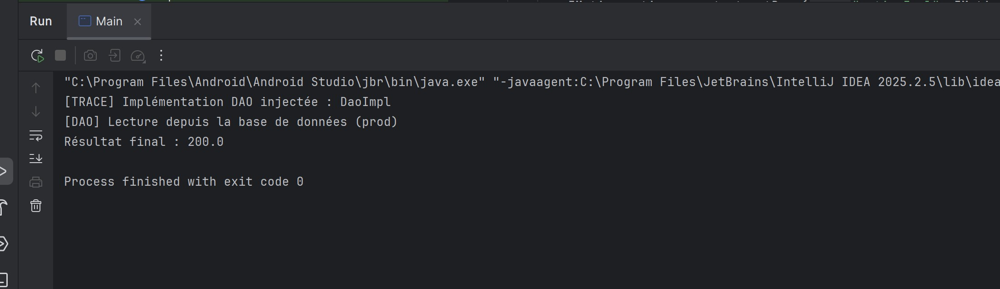
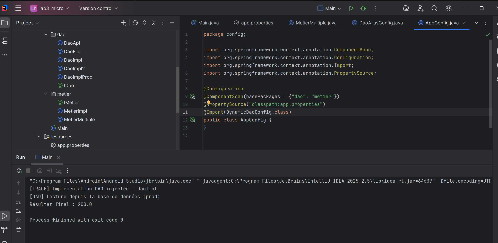
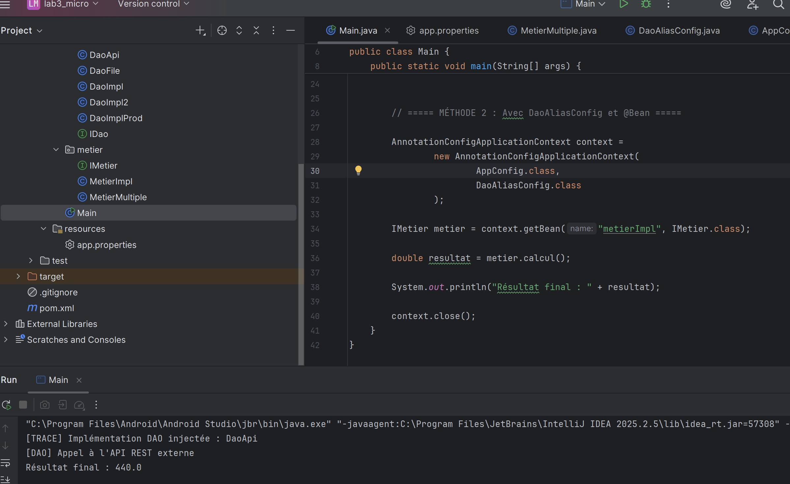
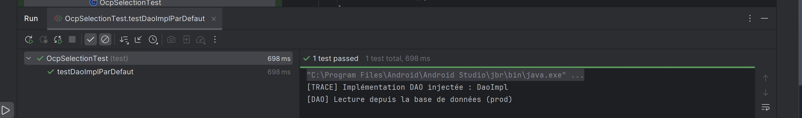

# TP 3 : Injection de dépendances avec Spring

Ce projet illustre l’utilisation de plusieurs implémentations DAO avec Spring.

## 1. Résultat avec DaoImpl

L’exécution avec `DaoImpl` affiche un résultat final de **200.0**.

## 2. Configuration Spring

`AppConfig` recherche les composants et charge la configuration du DAO dynamique.

## 3. Résultat avec DaoApi

L’exécution avec `DaoApi` affiche un résultat final de **440.0**.

## 4. Test unitaire

Le test `testDaoImplParDefaut` réussit avec l’implémentation `DaoImpl`.

